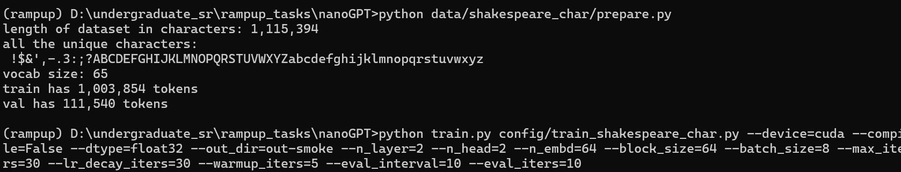
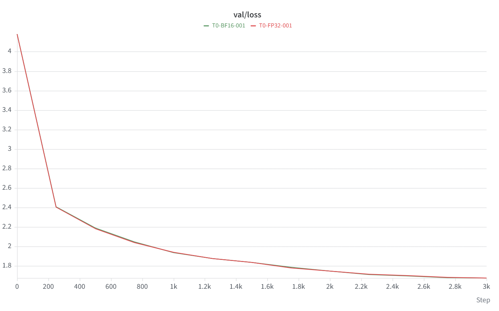
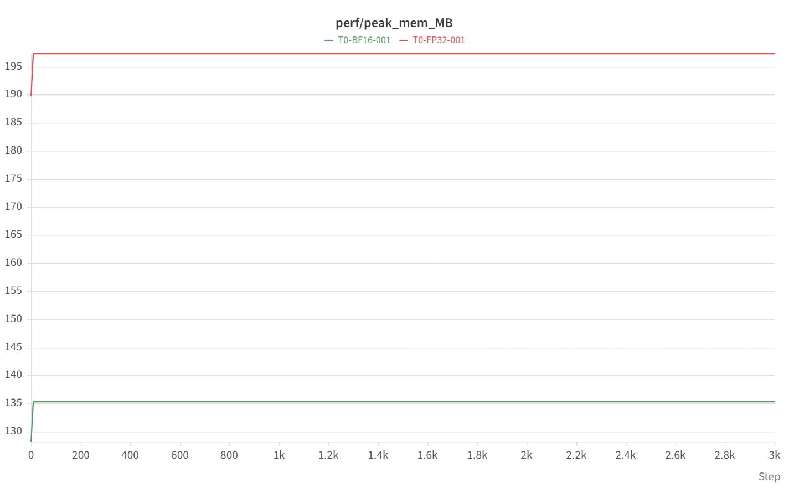
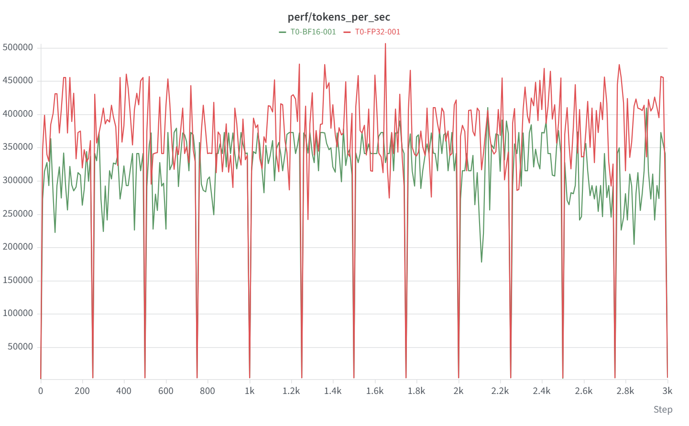
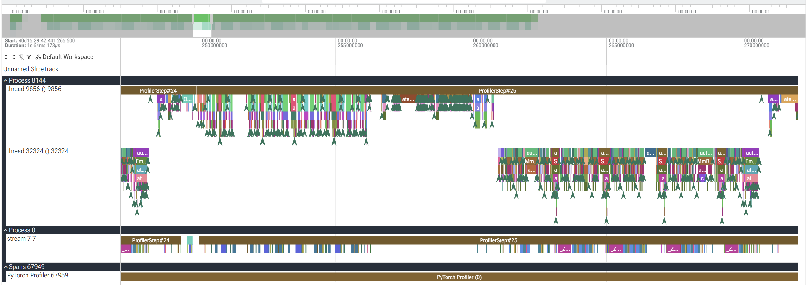
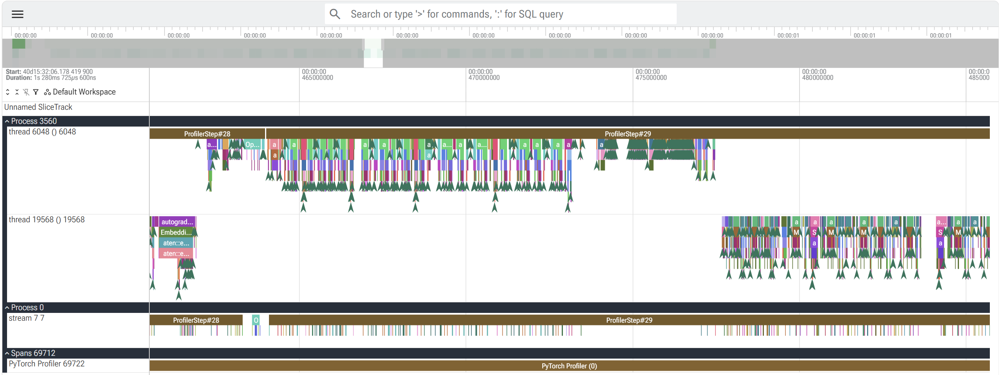

# Ramp-up 实验记录
251230032 冒吉宸

# Task 0 ：小型 Transformer 训练与推理


## 1. 摘要

基于nanoGPT复现了一个4层、4头128维的Transformer，参数量812,288。
完成了FP32与BF16 AMP 两组实验：
FP32的验证集loss为 1.6784，BF16为1.6767，相差 0.10%，**几乎无差别**；
BF16的峰值显存比FP32低了31.4%，但吞吐只低了12.6%。通过 torch.profiler 与 trace 统计定位了原因：BF16使GPU计算时间下降56%，却把每步的GPU kernel数从214增加到 264，所以AMP在这种规模下不能加速。


## 2. 环境

### 2.1 软硬件环境
>见system-info.txt(操作系统与硬件)
>environment.yml与pip-freeze.txt(python和pytorch版本等)

OS: Windows-10-10.0.26200-SP0
Python: 3.11.18 | packaged by conda-forge | (main, Oct 26 2026, 11:29:07) [MSC v.1944 64 bit (AMD64)]
PyTorch: 2.15.0+cu134
PyTorch CUDA: 13.4
cuDNN: 92600
GPU: NVIDIA GeForce RTX 5060 Laptop GPU
NVIDIA GeForce RTX 5060 Laptop GPU, 8151 MiB, 591.86


### 2.2 代码改动

拉取后先用原模型进行一个冒烟测试


能跑通

- 本地改动（共三个文件）：
  1. `train.py`：新增 ` run_tag / results_dir / profile*` 用于记录实验编号，日志位置等等；
  2. stdout/stderr把每次实验日志保存下来；
  3. 原代码会降级为TF32，把它关了，改用真FP32 ；
  4. 输出 val PPL，ppl=exp(loss)；
  5. checkpoint 拆分为 last(`ckpt.pt`) 与 best(`best_ckpt.pt`)；
  6. 记录 tokens/s 与峰值显存；
  7. 加入 `torch.profiler`(`wait/warmup/active` )；
  8. 结束时写出 `results/<run_tag>.json`；
  9.  `sample.py`：新增 `ckpt_name` ，可加载 `best_ckpt.pt`；
  10. `configurator.py`：读取 config 时指定 `encoding='utf-8'`(因为代码中包含中文注释，编码会报错)。
> 两次正式实验的 `git_sha` 分别为 `c7256c8`（FP32）与 `6fadc93`（BF16）。两次提交都是只提交了运行结果，train.py相同

### 2.3 复现步骤

```bash
git clone https://github.com/karpathy/nanoGPT.git nanoGPT
git -C nanoGPT checkout 3adf61e154c3fe3fca428ad6bc3818b27a3b8291
conda env create -f environment.yml
conda activate rampup
cd nanoGPT && python data/shakespeare_char/prepare.py
python train.py ../configs/task0_fp32.py
python train.py ../configs/task0_bf16.py
```

## 3. 训练数据

| 项目 | 值 |
| --- | --- |
| 数据集 | tinyshakespeare（char-level）nanogpt自带|
| 分词方式 | 按字符分，不按词分，65 个字符 → 65 个整数 |
| 词表大小 | 65(按字符分的所以更小，模型参数更小) |
| 训练 token 数 | 1,003,854 |
| 验证 token 数 | 111,540 |
| 划分方式 | 按位置切分：前 90% 训练、后 10% 验证 |

划分方式采用**按位置顺序切分**而非随机打乱，这样验证集和训练集相同句子更少，loss更准确


## 4. 模型


4 层 Transformer Block，每层 4 个注意力头，隐藏维度 128（head_dim = 32），FFN 中间层 512（4×128），上下文长度 128，dropout 0.1


## 5. 训练设置

### 5.1 参数

| 参数 | 值 | 解释 |
| --- | --- | --- |
| batch_size | 32 |一次训练迭代同时处理 32 条样本|
| gradient_accumulation_steps | 1 |梯度步数不累积，每次迭代直接更新参数|
| block_size | 128 |每条样本的长度是 128 个 token|
| tokens / iteration | 4,096 |每次迭代的token总数|
| max_iters | 3,000 |最多训练 3000 次迭代|
| optimizer | AdamW（β1=0.9, β2=0.99, weight_decay=0.1） |
| learning_rate | 1e-3（cosine 衰减至 1e-4） |
| warmup_iters | 100 |预热迭代数|
| grad_clip | 1.0 |
| dropout | 0.1 |随机丢弃 10% 的神经元输出|
| eval_interval / eval_iters | 250 / 100 |每训练 250 次迭代，做一次评估，每次评估时，用 100 个 batch 来估计 loss|
| log_interval | 10 |每训练 10 次迭代，打印一次训练日志 |
| 随机种子 | 1337 |
| compile | False |不启用编译加速|

### 5.2 两组实验的唯一差异

`git diff --no-index configs/task0_fp32.py configs/task0_bf16.py` 仅 4 行不同：

```diff
-out_dir = 'out/task0-fp32'
-run_tag = 'T0-FP32-001'
-wandb_run_name = 'T0-FP32-001'
-dtype = 'float32'
+out_dir = 'out/task0-bf16'
+run_tag = 'T0-BF16-001'
+wandb_run_name = 'T0-BF16-001'
+dtype = 'bfloat16'
```
前三行为标识，唯一不同的只有 `dtype`，其余全部一样

> FP32 组额外设置 `tf32 = False`。因为nanoGPT 自动将FP32变为 TF32（尾数仅 10 位）

## 6. 结果

### 6.1 主表

> 数据来源：results/T0-FP32-001.json、T0-BF16-001.json。
> tokens/s 用 median_tokens_per_sec

| Precision | Val loss | Val PPL | Tokens/s（中位数） | Peak memory | Training time | Checkpoint |
| --- | ---: | ---: | ---: | ---: | ---: | ---: |
| FP32 | 1.6784 | 5.36 | 374,624 | 197.3 MB | 50.2 s | 9.33 MiB |
| BF16 | 1.6767 | 5.35 | 327,423 | 135.3 MB | 55.3 s | 9.33 MiB |


### 6.2 训练曲线
使用W&B和trace


FP32 与 BF16 的验证集 loss 曲线，两条线几乎重合


两次的峰值显存对比，可看出BF16的峰值显存更低



两次的训练吞吐对比。FP32整体位于BF16上方；周期性向下的尖刺对应每 250 步一次的验证集测试。

### 6.3 两组差异分析

**精度**：BF16与FP32的val loss曲线基本重合，说明在这个实验**没有太大的精度损失**。

**显存**：197.3 → 135.3 MB，降低31.4%。以8GB显存计，两者占用均不足3%，**显存并非本任务的约束**。

**吞吐**：吞吐 = 处理的数据量/花的时间。中位数 374,624 → 327,423（−12.6%），平均 244,806 → 222,264（−9.2%）**BF16花的时间反而更多**。

**结论**：BF16在本规模下节约了显存，但速度降低了，AMP并没有带来加速。


## 7. profiler 分析

### 7.1 算子耗时分布

| 算子 | FP32 CUDA 时间 | 占比 | BF16 CUDA 时间 | 占比 |
| --- | ---: | ---: | ---: | ---: |
| `aten::mm` | 124.576 ms | 48.16% | 48.225 ms | 42.54% |
| attention 反向 | 59.422 ms | 22.97% | 9.222 ms | 8.13% |
| attention 前向 | 21.649 ms | 8.37% | 3.144 ms | 2.77% |
| `native_layer_norm` 反向 | 14.650 ms | 5.66% | 14.690 ms | 12.96% |
| `native_layer_norm` 前向 | 11.485 ms | 4.44% | 11.540 ms | 10.18% |
| `AdamW.step` | 8.725 ms | 3.37% | 8.477 ms | 7.48% |
| `aten::copy_` | —（可忽略） | — | 5.384 ms（2010 次） | 4.75% |
| `aten::add` | —（可忽略） | — | 3.630 ms（4140 次） | 3.20% |
| **合计（Self CUDA）** | **258.692 ms** | 100% | **113.368 ms** | 100% |
| 合计（Self CPU） | 961.968 ms | — | 1,261.0 ms | — |
> 绝对时间含 profiler


从`results/profiler/trace_T0-PROF-*.json`中进行数据筛选
|——|FP32|BF16|增幅|
| --- | --- | --- | --- |
| GPU kernel 数| 214 |264 | 增加23.4% |


> 改用 BF16 后，矩阵乘和 attention 大幅加速，约降为原来的 44%；但混合精度还带来 copy/add 小算子开销。

### 7.2 单步时间线
trace_fp32：


trace_bf16：


图像侧面印证，从上到下依次为主线程，PyTorch 的反向引擎线程，以及GPU侧CUDA context在trace里的表示


### 7.3 结论：AMP 为什么没有加速

1.BF16 在 GPU 上确实更快，GPU 侧计算时间整体下降 56%。

2.但这些节省没有转化为端到端加速。端到端每步时间反而从 16.73 ms 升至 18.43 ms（+10.2%），吞吐下降 12.6%。

3.每步 GPU 实际计算时间只有 8.62 ms（FP32）与 3.78 ms（BF16），而每步端到端时间为 16.73 / 18.43 ms，即 GPU 分别有 63.3% 与 87.6% 的时间处于空闲。

4.BF16 下每步 GPU kernel 数从 214 增至 264（+23.4%），增量来自 autocast 插入的类型转换算子（`aten::copy_` 达 2010 次，`aten::add` 达 4140 次）。CPU 侧总时间相应从 962 ms 升至 1,261 ms。每一步的总耗时由"CPU 把 200 多个 kernel 依次下发"决定，从而使得计算时间的节省被调度开销吃掉了。

5.**由此推出**，当每步计算量增大到 GPU 不再是空闲状态时，BF16 会变快。


## 8. 生成样例


两组使用完全相同的推理设置，从各自的 `best_ckpt.pt` 生成：

| 参数 | 值 |
| --- | --- |
| prompt | `ROMEO:` |
| num_samples | 3 |
| max_new_tokens | 200 |
| temperature | 0.8 |
| top_k （每步只保留概率最高的 k 个 token）| 200 |
| seed | 1337 |
| dtype | 与该 checkpoint 训练时一致（float32 / bfloat16） |

生成结果见results/samples_bf16.txt和samples_fp32.txt


## 9. 相关问题思考

### 9.1 loss 与 PPL 的含义

loss 是交叉熵：模型对下一个字符输出 65 个 logits，经 softmax 得到概率 `p`，loss = `-ln(p_正确答案)`，一批 token 取平均，单位为 nats。它衡量"模型给正确答案分配的概率有多低"。

PPL（困惑度）定义为 `PPL = e^loss`，等于"平均猜中概率的倒数"，可理解为模型平均在多少个**等概率**候选之间犹豫。

模型初始化时输出接近均匀分布，`p = 1/65`，故 `loss = ln(65) = 4.174`。实测 step 0 的 loss 为 4.1818、PPL 65.37，与该理论值吻合，说明初始化和 loss 计算正确。训练 3000 步后 loss 降至 1.6784，PPL 5.36——从"65 选 1"进步到"约 5 选 1"。

### 9.2 batch size、梯度累积、显存、稳定性、速度的关系

**显存**：激活值规模正比于 `batch_size × block_size × 维度 × 层数`。

**稳定性**：一个 batch 的梯度是若干样本梯度的平均。batch 越大，梯度方向越接近真实梯度，loss 曲线越平滑，更稳定。

**速度**：batch 增大后每步更慢，但一次 kernel 下发处理的数据更多，固定开销被摊薄，故**吞吐（tokens/s）通常上升**。

**梯度累积（GA）**：连做多次前向/反向、梯度累加后再更新一次。它只改变参数更新的频率，不改变显存占用，因此是"显存不够时模拟大 batch"的手段。

### 9.3 AMP 可能加速或不加速的原因
前面解释过了

### 9.4 checkpoint 如何对应 commit 与 W&B run

**checkpoint 内部**：`best_ckpt.pt` 是一个字典，包含 `model`（812,288 个参数值）、`optimizer`（AdamW 状态）、`model_args`（层数/头数/维度/词表）、`iter_num`、`best_val_loss`、`config`（全部超参）。仅凭该文件即可重建模型结构，不依赖外部记忆。

拿到 `best_ckpt.pt` 后，从对应 json 读出 `git_sha`，`git checkout` 该 commit，按 `environment.yml` 建环境，执行 `python train.py ../configs/task0_fp32.py` 即可得到等价权重。