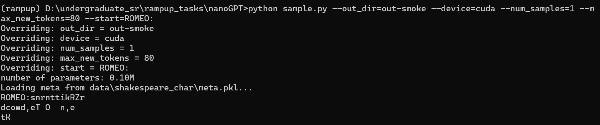

# Ramp-up 实验记录
251230032 冒吉宸

# Task 0 ：小型 Transformer 训练与推理


## 1. 摘要

基于nanoGPT复现了一个4层、4头128维的Transformer，参数量812,288。
完成了FP32与BF16 AMP 两组实验：
FP32的验证集loss为 1.6784，BF16为1.6767，相差 0.10%，**几乎无差别**；
BF16的峰值显存比FP32低了31.4%，但吞吐却低了12.6%。通过 torch.profiler 与 trace 统计定位了原因：BF16使GPU计算时间下降56%，却把每步的GPU GPU 活动事件数从214增加到 264，所以AMP在这种规模下不能加速。


## 2. 环境

### 2.1 软硬件环境
>见system-info.txt(操作系统与硬件)
>environment.yml与pip-freeze.txt(python和pytorch版本等)

OS: Windows-10-10.0.26200-SP0
Python: 3.11.18 | packaged by conda-forge | (main, Oct 26 2026, 11:29:07) [MSC v.1944 64 bit (AMD64)]
PyTorch: 2.15.0+cu134
PyTorch CUDA: 13.4
cuDNN: 92600
GPU: NVIDIA GeForce RTX 5060 Laptop GPU
NVIDIA GeForce RTX 5060 Laptop GPU, 8151 MiB, 591.86


### 2.2 代码改动

拉取后先用原模型进行一个冒烟测试


能跑通

- 本地改动（共三个文件）：
  1. `train.py`：新增 ` run_tag / results_dir / profile*` 用于记录实验编号，日志位置等等；
  2. stdout/stderr把每次实验日志保存下来；
  3. 原代码会降级为TF32，把它关了，改用真FP32 ；
  4. 输出 val PPL，ppl=exp(loss)；
  5. checkpoint 拆分为 last(`ckpt.pt`) 与 best(`best_ckpt.pt`)；
  6. 记录 tokens/s 与峰值显存；
  7. 加入 `torch.profiler`(`wait/warmup/active` )；
  8. 结束时写出 `results/<run_tag>.json`；
  9.  `sample.py`：新增 `ckpt_name` ，可加载 `best_ckpt.pt`；
  10. `configurator.py`：读取 config 时指定 `encoding='utf-8'`(因为代码中包含中文注释，编码会报错)。
> 两次正式实验的 `git_sha` 分别为 `c7256c8`（FP32）与 `6fadc93`（BF16）。两次提交都是只提交了运行结果，train.py相同

### 2.3 复现步骤

```
git clone git@github.com:kaizs9557/undergraduate_sr_rampup_tasks.git
cd undergraduate_sr_rampup_tasks
git checkout ccf788a
conda env create -f environment.yml
conda activate rampup
cd nanoGPT
python data/shakespeare_char/prepare.py
python train.py ../task0/configs/task0_fp32.py
python train.py ../task0/configs/task0_bf16.py
```

## 3. 训练数据

| 项目 | 值 |
| --- | --- |
| 数据集 | tinyshakespeare（char-level）nanogpt自带|
| 分词方式 | 按字符分，不按词分，65 个字符 → 65 个整数 |
| 词表大小 | 65(按字符分的所以更小，模型参数更小) |
| 训练 token 数 | 1,003,854 |
| 验证 token 数 | 111,540 |
| 划分方式 | 按位置切分：前 90% 训练、后 10% 验证 |

划分方式采用**按位置顺序切分**而非随机打乱，这样验证集和训练集相同句子更少，loss更准确


## 4. 模型


4 层 Transformer Block，每层 4 个注意力头，隐藏维度 128（head_dim = 32），FFN 中间层 512（4×128），上下文长度 128，dropout 0.1


## 5. 训练设置

### 5.1 参数

| 参数 | 值 | 解释 |
| --- | --- | --- |
| batch_size | 32 |一次训练迭代同时处理 32 条样本|
| gradient_accumulation_steps | 1 |梯度步数不累积，每次迭代直接更新参数|
| block_size | 128 |每条样本的长度是 128 个 token|
| tokens / iteration | 4,096 |每次迭代的token总数|
| max_iters | 3,000 |最多训练 3000 次迭代|
| optimizer | AdamW（β1=0.9, β2=0.99, weight_decay=0.1） |
| learning_rate | 1e-3（cosine 衰减至 1e-4） |
| warmup_iters | 100 |预热迭代数|
| grad_clip | 1.0 |
| dropout | 0.1 |随机丢弃 10% 的神经元输出|
| eval_interval / eval_iters | 250 / 100 |每训练 250 次迭代，做一次评估，每次评估时，用 100 个 batch 来估计 loss|
| log_interval | 10 |每训练 10 次迭代，打印一次训练日志 |
| 随机种子 | 1337 |
| compile | False |不启用编译加速|

### 5.2 两组实验的唯一差异

`git diff --no-index task0/configs/task0_fp32.py task0/configs/task0_bf16.py` 仅 4 行不同：

```diff
-out_dir = 'out/task0-fp32'
-run_tag = 'T0-FP32-001'
-wandb_run_name = 'T0-FP32-001'
-dtype = 'float32'
+out_dir = 'out/task0-bf16'
+run_tag = 'T0-BF16-001'
+wandb_run_name = 'T0-BF16-001'
+dtype = 'bfloat16'
```
前三行为标识，唯一不同的只有 `dtype`，其余全部一样

> 设置 `tf32 = False`。因为nanoGPT 自动将FP32变为 TF32（尾数仅 10 位）

## 6. 结果

### 6.1 主表

> 数据来源：task0/results/T0-FP32-001.json、T0-BF16-001.json。
> tokens/s 用 median_tokens_per_sec

| Precision | Val loss | Val PPL | Tokens/s（中位数） | Peak memory | Training time | Checkpoint |
| --- | ---: | ---: | ---: | ---: | ---: | ---: |
| FP32 | 1.6784 | 5.36 | 374,624 | 197.3 MB | 50.2 s | 9.33 MiB |
| BF16 | 1.6767 | 5.35 | 327,423 | 135.3 MB | 55.3 s | 9.33 MiB |


### 6.2 训练曲线
使用W&B和trace


FP32 与 BF16 的验证集 loss 曲线，两条线几乎重合


两次的峰值显存对比，可看出BF16的峰值显存更低


两次的训练吞吐对比。FP32整体位于BF16上方；周期性向下的尖刺对应每 250 步一次的验证集测试。

### 6.3 两组差异分析

**精度**：BF16与FP32的val loss曲线基本重合，说明在这个实验**没有太大的精度损失**。

**显存**：197.3 → 135.3 MB，降低31.4%。以8GB显存计，两者占用均不足3%，**显存并非本任务的约束**。

**吞吐**：吞吐 = 处理的数据量/花的时间。中位数 374,624 → 327,423（−12.6%），平均 244,806 → 222,264（−9.2%）**BF16花的时间反而更多**。

**结论**：BF16在本规模下节约了显存，但速度降低了，AMP并没有带来加速。


## 7. profiler 分析

### 7.1 算子耗时分布

| 算子 | FP32 CUDA 时间 | 占比 | BF16 CUDA 时间 | 占比 |
| --- | ---: | ---: | ---: | ---: |
| `aten::mm` | 124.576 ms | 48.16% | 48.225 ms | 42.54% |
| attention 反向 | 59.422 ms | 22.97% | 9.222 ms | 8.13% |
| attention 前向 | 21.649 ms | 8.37% | 3.144 ms | 2.77% |
| `native_layer_norm` 反向 | 14.650 ms | 5.66% | 14.690 ms | 12.96% |
| `native_layer_norm` 前向 | 11.485 ms | 4.44% | 11.540 ms | 10.18% |
| `AdamW.step` | 8.725 ms | 3.37% | 8.477 ms | 7.48% |
| `aten::copy_` | —（可忽略） | — | 5.384 ms（2010 次） | 4.75% |
| `aten::add` | —（可忽略） | — | 3.630 ms（4140 次） | 3.20% |
| **合计（Self CUDA）** | **258.692 ms** | 100% | **113.368 ms** | 100% |
| 合计（Self CPU） | 961.968 ms | — | 1,261.0 ms | — |
> 绝对时间含 profiler


从`results/profiler/trace_T0-PROF-*.json`中进行数据筛选
|——|FP32|BF16|增幅|
| --- | --- | --- | --- |
| GPU 活动事件数| 214 |264 | 增加23.4% |


> 改用 BF16 后，矩阵乘和 attention 大幅加速，约降为原来的 44%；但混合精度还带来 copy/add 小算子开销。

### 7.2 单步时间线
trace_fp32：


trace_bf16：


图像侧面印证，从上到下依次为主线程，PyTorch 的反向引擎线程，以及GPU侧CUDA context在trace里的表示


### 7.3 结论：AMP 为什么没有加速

1.BF16 在 GPU 上确实更快，GPU 侧计算时间整体下降 56%。

2.但这些节省没有转化为端到端加速。端到端每步时间反而从 16.73 ms 升至 18.43 ms（+10.2%），吞吐下降 12.6%。

3.每步 GPU 实际计算时间只有 8.62 ms（FP32）与 3.78 ms（BF16），而每步端到端时间为 16.73 / 18.43 ms，即 GPU 分别有 63.3% 与 87.6% 的时间处于空闲。

4.BF16 下每步 GPU 活动事件数从 214 增至 264（+23.4%），增量来自 autocast 插入的类型转换算子（`aten::copy_` 达 2010 次，`aten::add` 达 4140 次）。CPU 侧总时间相应从 962 ms 升至 1,261 ms。每一步的总耗时由"CPU 把 200 多个 kernel 依次下发"决定，从而使得计算时间的节省被调度开销吃掉了。

5.**由此推出**，当每步计算量增大到 GPU 不再是空闲状态时，BF16 会变快。


## 8. 生成样例


两组使用完全相同的推理设置，从各自的 `best_ckpt.pt` 生成：

| 参数 | 值 |
| --- | --- |
| prompt | `ROMEO:` |
| num_samples | 3 |
| max_new_tokens | 200 |
| temperature | 0.8 |
| top_k （每步只保留概率最高的 k 个 token）| 200 |
| seed | 1337 |
| dtype | 与该 checkpoint 训练时一致（float32 / bfloat16） |

生成结果见task0/results/samples_bf16.txt和samples_fp32.txt


## 9. 相关问题思考

### 9.1 loss 与 PPL 的含义

loss 是交叉熵：模型对下一个字符输出 65 个 logits，经 softmax 得到概率 `p`，loss = `-ln(p_正确答案)`，一批 token 取平均，单位为 nats。它衡量"模型给正确答案分配的概率有多低"。

PPL（困惑度）定义为 `PPL = e^loss`，等于"平均猜中概率的倒数"，可理解为模型平均在多少个**等概率**候选之间犹豫。

模型初始化时输出接近均匀分布，`p = 1/65`，故 `loss = ln(65) = 4.174`。实测 step 0 的 loss 为 4.1818、PPL 65.37，与该理论值吻合，说明初始化和 loss 计算正确。训练 3000 步后 loss 降至 1.6784，PPL 5.36——从"65 选 1"进步到"约 5 选 1"。

### 9.2 batch size、梯度累积、显存、稳定性、速度的关系

**显存**：激活值规模正比于 `batch_size × block_size × 维度 × 层数`。

**稳定性**：一个 batch 的梯度是若干样本梯度的平均。batch 越大，梯度方向越接近真实梯度，loss 曲线越平滑，更稳定。

**速度**：batch 增大后每步更慢，但一次 kernel 下发处理的数据更多，固定开销被摊薄，故**吞吐（tokens/s）通常上升**。

**梯度累积（GA）**：连做多次前向/反向、梯度累加后再更新一次。它只改变参数更新的频率，不改变显存占用，因此是"显存不够时模拟大 batch"的手段。

### 9.3 AMP 可能加速或不加速的原因
前面解释过了

### 9.4 checkpoint 如何对应 commit 与 W&B run

**checkpoint 内部**：`best_ckpt.pt` 是一个字典，包含 `model`（812,288 个参数值）、`optimizer`（AdamW 状态）、`model_args`（层数/头数/维度/词表）、`iter_num`、`best_val_loss`、`config`（全部超参）。仅凭该文件即可重建模型结构，不依赖外部记忆。

拿到 `best_ckpt.pt` 后，从对应 json 读出 `git_sha`，`git checkout` 该 commit，按 `environment.yml` 建环境，执行 `python train.py ../task0/configs/task0_fp32.py`


# Task 1：INT8 模型量化

## 1. 摘要

基于 Task 0 的 nanoGPT，实现均匀线性 INT8 量化，并比较逐张量 PTQ（Q1）、逐通道 PTQ（Q2）与简化 QAT（Q3）。量化对象是模型中的 17 个 `Linear` 层：权重使用对称量化，层输入激活使用静态非对称量化；Embedding、LayerNorm 等部分保持浮点计算。激活范围由训练集的 128 个 batch 校准，**QAT 从 Task 0 最佳 checkpoint 出发微调 400 步**。

在固定的验证样本上，BF16 基线、Q1、Q2、Q3 的 loss 分别为 **1.677677、1.678301、1.678028、1.667754**。Q2 略优于 Q1；Q3 最低，**但它额外训练了 400 步**。
逐层统计发现部分激活的最大值明显高于 P99.9；以一个 MLP 层为例，将量化范围分析性地截到 P99.9，可使激活平均绝对重建误差从 0.003740 降到 0.002175。

## 2. 实验基础与范围
模型，数据集和与task0相同(tiny Shakespeare)，按字符编码，词表大小为 65
Task 1 使用 BF16 训练得到的 `nanoGPT/out/task0-bf16/best_ckpt.pt`，其 checkpoint step 为 3000。
Task 1 的随机数种子与task0相同，为 1337。

| 环节 | 数据与设置 | 是否更新权重 |
| --- | --- | --- |
| 激活校准与异常值统计 | 训练集 128 batch，batch size 32，block size 128 | 否 |
| 基线、Q1、Q2、Q3 验证 | 验证集 100 batch，batch size 32，block size 128；相同随机起点，共 409,600 个预测位置 | 否 |
| Q3 微调 | 训练集，400 step，batch size 32，block size 128，学习率 `5e-5` | 是 |

task1验证起点与task0不同，因此best_val_loss不同

## 3. 量化方法与正确性检查

### 3.1 均匀线性量化

对浮点数 `x`，使用 scale `s` 和整数零点 `z`：

```text
q     = clip(round(x / s) + z, qmin, qmax)
x_hat = (q - z) * s
```

`q` 是 INT8 整数，`x_hat` 是反量化后的近似浮点值。实现见 [`quant_core.py`](./task1/quant_core.py)。
权重采用**对称量化**：`s = max(abs(w)) / 127`、`z = 0`、整数范围 `[-127, 127]`。
激活采用**带零点的非对称量化**：先将校准区间扩展到包含实数 0，再令 `s = (x_max - x_min) / 255`，`z = clip(round(-128 - x_min/s), -128, 127)`，整数范围 `[-128, 127]`。(这样可以让0点包含在范围内)


[`quant_demo.py`](./task1/quant_demo.py)  小矩阵手写代码练习

### 3.2 校准、Q1、Q2、Q3

[`calibrate_ranges.py`](./task1/calibrate_ranges.py) 在原始 checkpoint 的 17 个 Linear 层前登记 hook，使用固定的 128 个训练 batch 记录每层**输入激活**的最小值和最大值，计算静态 `scale`/`zero_point`，保存到 [`results/activation_ranges.json`](./task1/results/activation_ranges.json)。校准只做前向观察，不执行反向传播或参数更新。

| 配置 | 权重量化 | 激活量化 | 训练方式 |
| --- | --- | --- | --- |
| Q1 | INT8 对称逐张量：一个权重矩阵共用一个 scale | INT8 一层用一个：使用校准后的固定参数 | PTQ，不额外训练 |
| Q2 | INT8 对称逐通道：每个输出行各用一个 scale | 与 Q1 相同 | PTQ，不额外训练 |
| Q3 | 与 Q2 相同，前向过程中重算当前权重的逐通道 scale | 与 Q1 相同 | 简化 QAT，额外微调 400 步 |

[`ptq_q1.py`](./task1/ptq_q1.py) 和 [`ptq_q2.py`](./task1/ptq_q2.py) 从同一 Task 0 checkpoint 出发，先将权重量化再反量化，写回推理用的浮点 Linear；**输入激活在每次前向时按固定校准参数做 fake quantization**。因为 `lm_head` 与 token embedding 原本共享权重，PTQ 脚本在原地写回前复制 `lm_head.weight`，避免连带改动 embedding。

QAT 使用 [`qat_layers.py`](./task1/qat_layers.py) 中的 `QATLinear`：前向计算使用激活与权重的量化近似值，但保留可训练的浮点权重，这样更新权重时可以使用；[`qat_train.py`](./task1/qat_train.py) 从 Task 0 最佳 checkpoint 开始，使用 AdamW（`β1=0.9`、`β2=0.99`、`weight_decay=0.1`）和梯度范数裁剪 1.0 微调 400 步。[`qat_q3.py`](./task1/qat_q3.py) 再按相同验证抽样评估 Q3。

## 4. 验证结果与权重存储

### 4.1 精度比较

在相同的 100 个验证 batch 上计算，`PPL = exp(平均 loss)`。BF16 基线使用自动混合精度。两种基线均加载**同一个由 BF16 训练得到的 checkpoint**，区别是验证前向的计算精度。

| 方法 | 验证 loss | 验证 PPL | 结果文件 |
| --- | ---: | ---: | --- |
| FP32 计算对照 | 1.677602 | 5.352706 | [`baseline_metrics.json`](./task1/results/baseline_metrics.json) |
| BF16 autocast 基线 | 1.677677 | 5.353106 | [`bf16_metrics.json`](./task1/results/bf16_metrics.json) |
| Q1：逐张量 W8A8 PTQ | 1.678301 | 5.356445 | [`q1_metrics.json`](./task1/results/q1_metrics.json) |
| Q2：逐通道 W8A8 PTQ | 1.678028 | 5.354983 | [`q2_metrics.json`](./task1/results/q2_metrics.json) |
| Q3：逐通道 W8A8 QAT | 1.667754 | 5.300249 | [`q3_metrics.json`](./task1/results/q3_metrics.json) |

相对 FP32 计算对照，Q1、Q2 的 loss 分别增加约 0.000698、0.000425；Q2 比 Q1 低约 0.000273。在本次固定验证样本上，逐通道权重量化的误差略小。Q3 的 loss 比 Q2 低约 0.010274，但 Q3 比 Q2 多进行了 400 步微调；本实验没有额外运行“同样微调 400 步但不量化”的控制组，故不能把这一差值单独归因于 QAT。

### 4.2 权重误差

[`analyze_weights.py`](./task1/analyze_weights.py) 对原始 checkpoint 的 17 个 Linear 权重输出逐层 min/max、mean、std、RMS、通道最大绝对值及 Q1/Q2 反量化误差，完整结果见 [`weight_stats.json`](./task1/results/weight_stats.json)。17 层中，Q2 的**权重平均绝对重建误差**均低于 Q1。以 `transformer.h.0.mlp.c_fc` 为例，该层权重形状为 `[512,128]`，Q1 的平均绝对误差为 0.000359，Q2 为 0.000169。逐通道 scale 可以避免由其他行的大权重决定这一行的量化步长。


## 5. 激活异常值分析

### 5.1 分布与位置

[`analyze_activations.py`](./task1/analyze_activations.py) 复用与校准相同的 128 个训练 batch，对 17 层输入激活统计 min/max、mean、std、RMS、每个输入通道的最大绝对值，以及绝对值 P99、P99.9、P99.99(包括了边界近似值)。逐层明细和直方图计数保存在 [`activation_stats.json`](./task1/results/activation_stats.json)。

按 `最大绝对值 / P99.9 绝对值` 排序，幅度最突出的层如下：

| Linear 输入层 | 最大绝对值 | P99.9 绝对值 | 比值 | 实际 scale | 平均绝对量化误差 |
| --- | ---: | ---: | ---: | ---: | ---: |
| `transformer.h.1.mlp.c_proj` | 3.635 | 1.573 | 2.31 | 0.014920 | 0.003740 |
| `transformer.h.2.attn.c_proj` | 2.036 | 0.918 | 2.22 | 0.014118 | 0.003529 |
| `transformer.h.1.attn.c_proj` | 1.455 | 0.702 | 2.07 | 0.010977 | 0.002744 |

第一行的 P99.9 绝对值约为 1.573，而最大绝对值达到 3.635
### 5.2 异常字符位置和通道

[`analyze_outlier_impact.py`](./task1/analyze_outlier_impact.py) 将各层 `|activation| > P99.9` 作为异常数字。发现在 `transformer.h.1.mlp.c_proj` 中，超过阈值的激活数字约占 **0.0998%**，但约 **47.22%** 的字符位置至少有一个异常通道。
比如字符 `'a'` 的 25,868 个采样位置中有 25,866 个至少出现一个异常通道；所以这并不能证明该字符造成异常

### 5.3 截断范围对量化误差的影响

作为分析性对照，固定原模型和同一批训练样本，**将每层激活量化范围限制在其 `±P99.9` 以内**，**重新计算非对称 scale/zero point**，并比较激活量化再反量化后的平均绝对误差。
以 `transformer.h.1.mlp.c_proj` 为例，将上界截到 P99.9 的 1.573 后，scale 从 **0.014920** 降至 **0.006833**（减小 54.2%），平均绝对重建误差从 **0.003740** 降至 **0.002175**（*减小约 41.8%*）。
17 层的这一局部误差在本次校准样本上均下降，完整数据见 [`outlier_impact.json`](./task1/results/outlier_impact.json)。


## 6. 需要说明的地方

1. Q1/Q2/Q3 使用 fake quantization：量化与反量化制造 INT8 近似误差，随后仍用浮点 Linear 计算。本实验没有测量真正整数 GEMM 的推理速度或能耗。
2. Q3 除量化训练策略外，还比 Q1/Q2 多 400 步参数更新；缺少同等步数的浮点微调控制组，Q3 的提升不能完全归因于 QAT。
3. 异常值截断实验只比较**激活重建误差**，没有报告截断后模型的验证精度。

## 7. 复现说明

若要复现一定要先用 `nanoGPT/data/shakespeare_char/prepare.py` 生成 `train.bin`、`val.bin` 和 `meta.pkl`。源 checkpoint可以在 `nanoGPT` 目录运行：
**这些都没有上传到git！**


然后返回仓库根目录，按依赖顺序运行：

```cmd
python task1/quant_demo.py
python task1/calibrate_ranges.py
python task1/eval_baseline.py
python task1/eval_bf16.py
python task1/ptq_q1.py
python task1/ptq_q2.py
python task1/qat_train.py
python task1/qat_q3.py
python task1/analyze_weights.py
python task1/analyze_activations.py
python task1/analyze_outlier_impact.py
```

本报告使用的源文件 SHA-256：

| 文件 | SHA-256 |
| --- | --- |
| `nanoGPT/out/task0-bf16/best_ckpt.pt` | `7e02b54a28ae3298b35bfb76886f0594b7cbe6bd992ede2e5bbd342e5eff87af` |
| `nanoGPT/data/shakespeare_char/train.bin` | `6ec305602a99ac2802745a134e1f5e33e2231b4855525b00b9aebb730ac2626f` |
| `nanoGPT/data/shakespeare_char/val.bin` | `d37d30cc0c8327c270d493299c3dca54135f6d5f1c9ef60cda78076e311204b1` |